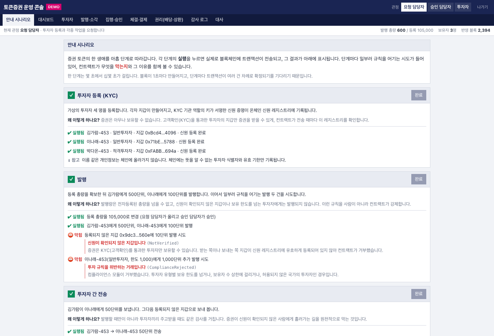
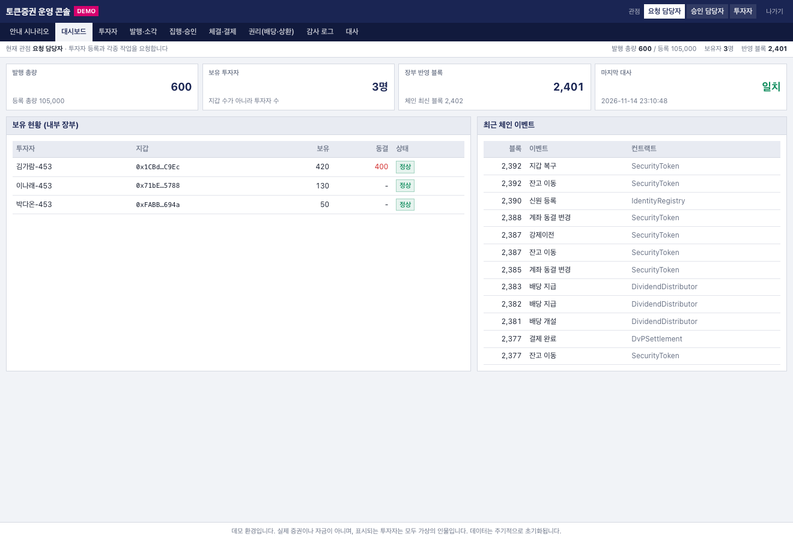
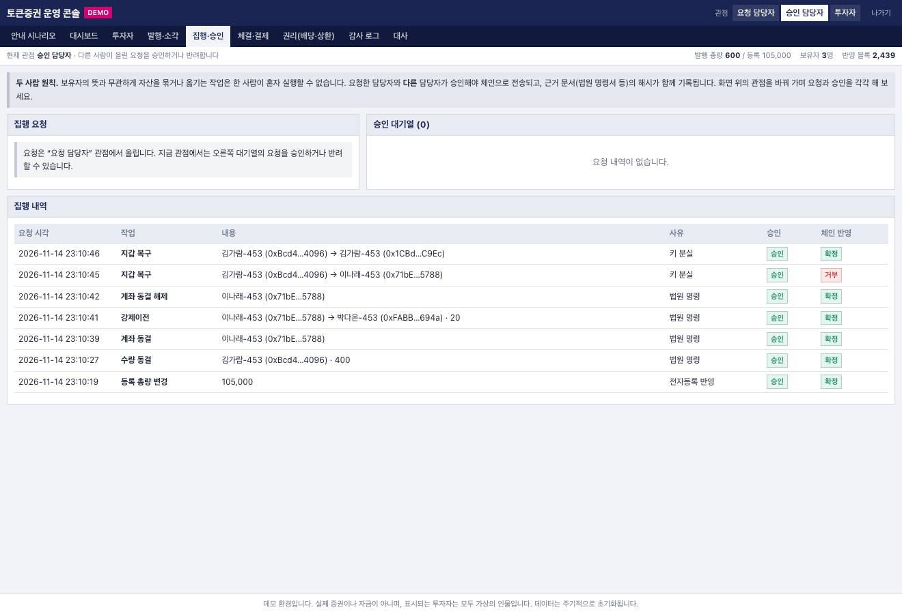
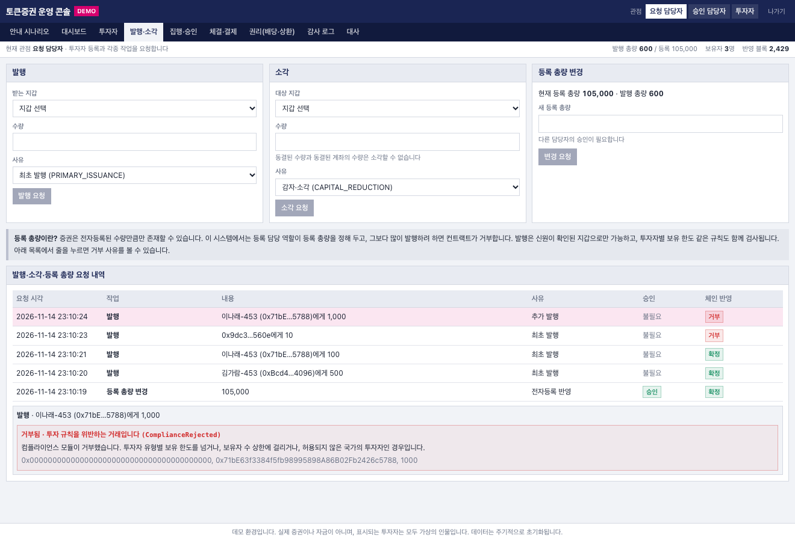
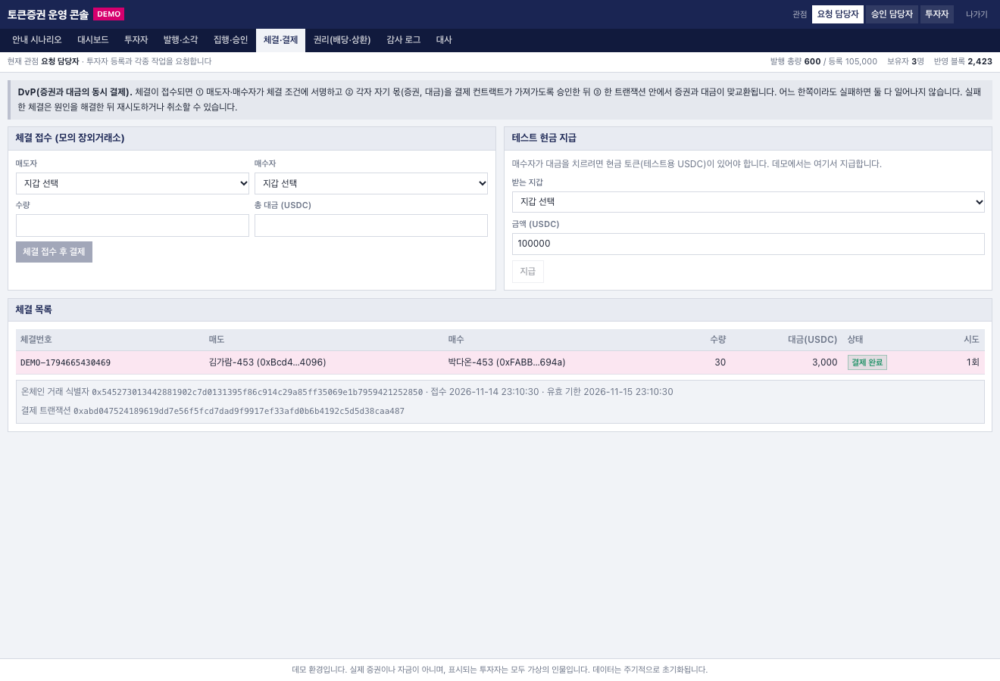
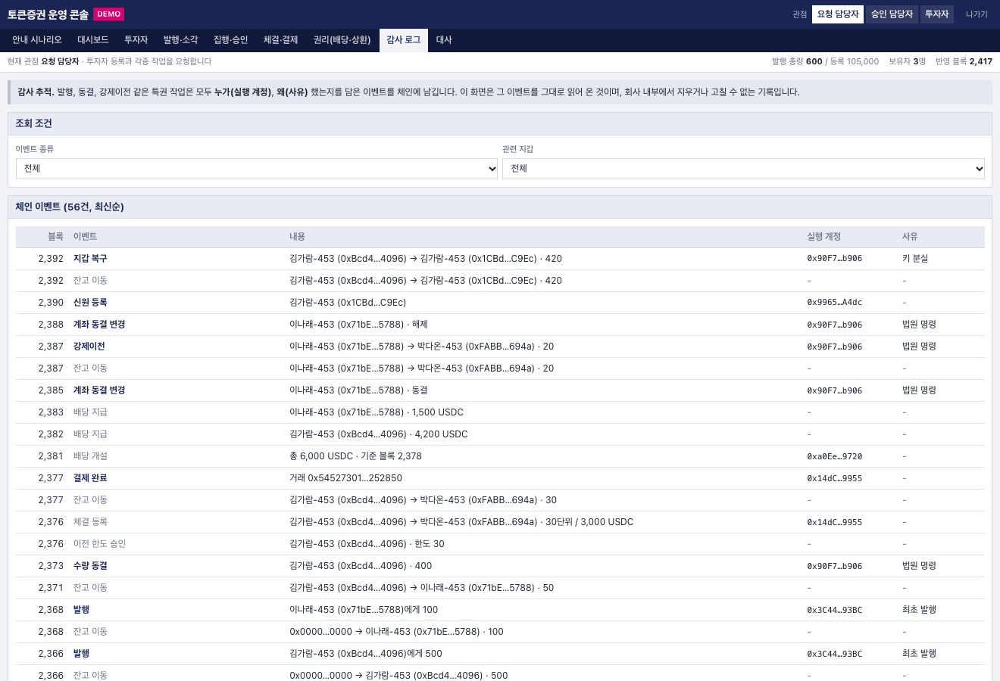
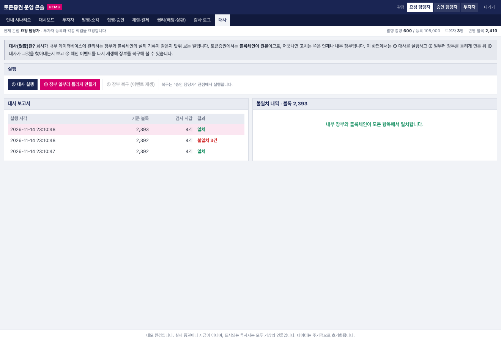
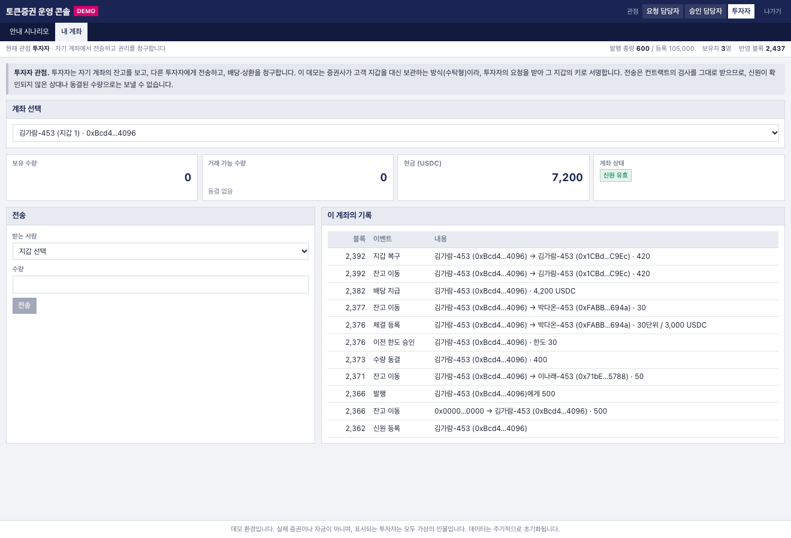

# sto-platform

Security token contracts (ERC-3643 / ERC-1400) with DvP settlement on a permissioned Hyperledger Besu network.

> The contracts in this repository have not been audited. Do not use them in production.

A visitor enters the demo with one click and walks through nine steps that send real transactions, including the attempts the contracts must reject:



## Quick start

Everything on one machine: four Besu validators, PostgreSQL, the backend and the frontend. Requires Docker and Node.js (the contracts are deployed from the host).

```bash
./infra/demo/up.sh       # generate the chain, start it, deploy the contracts, start the apps
open http://localhost:4790
./infra/demo/reset.sh    # back to the initial state: fresh contracts, empty database
```

`up.sh` can be run again at any time; it keeps an existing chain and deployment. `reset.sh` deploys a fresh set of contracts on the running chain, empties the database and restarts the backend, so the demo can be returned to a known state on a schedule.

## Repository layout

```
contracts/        Hardhat project: Solidity sources, tests, scripts
backend/          NestJS API
frontend/         Next.js operator console and guided demo
docs/screenshots/ Screens used in this README
infra/besu/       Local 4-validator QBFT network (Docker Compose)
infra/postgres/   PostgreSQL for the backend (Docker Compose)
infra/demo/       The whole system in one Compose project, with start and reset scripts
```

## Requirements

- Node.js 22.13 or later
- Docker with Compose v2

## Contracts

```bash
cd contracts
npm ci
npm run build        # compile
npm test             # run the test suite
npm run coverage     # tests with a coverage report
npm run size         # deployed bytecode size against the 24,576-byte limit
npm run typecheck    # compile, then type-check tests and scripts
```

Static analysis uses [Slither](https://github.com/crytic/slither):

```bash
pip install slither-analyzer
slither . --fail-medium
```

Toolchain: Hardhat 3, Solidity 0.8.34 (EVM target `cancun`), OpenZeppelin Contracts 5.6, ethers v6, Mocha.

### Architecture

```
                 ┌──────────────────────┐
                 │   IdentityRegistry   │  wallet -> investor, KYC status
                 └──────────▲───────────┘
                            │ isVerified / investorOf
┌──────────────┐   ┌────────┴───────────┐   canTransfer   ┌───────────────────┐
│ ERC1967Proxy ├──►│   SecurityToken    ├────────────────►│ ModularCompliance │
└──────────────┘   │  (UUPS, ERC-7201)  │                 └─────────┬─────────┘
                   └────────▲───────────┘                           │ moduleCheck
                            │ investorBalanceOf / holderCount       ▼
                            └──────────────────────────  MaxBalance · MaxHolders · CountryAllow
```

The token keeps the per-investor aggregates; rule modules are stateless and read them. Rules can therefore be added to, removed from or replaced on a live token without migrating any state.

Audited OpenZeppelin components are used wherever one exists: `ERC20Upgradeable`, `AccessControlDefaultAdminRulesUpgradeable`, `PausableUpgradeable`, `UUPSUpgradeable`, `Checkpoints`, `EIP712`, `ECDSA`, `Ownable2Step`. Only the securities-specific logic is written here.

### IdentityRegistry

Maps wallets to investors. A trusted KYC issuer signs an EIP-712 claim off-chain and a registrar submits it; no personal data is stored on-chain.

```
InvestorClaim(address wallet, bytes32 investorId, uint16 country, uint8 investorType, uint64 expiry, uint256 nonce)
```

| Rule | Behaviour |
|---|---|
| Who can sign | Only issuers added by the admin with `setTrustedIssuer` |
| Who can submit | `REGISTRAR_ROLE` |
| Replay protection | EIP-712 domain (chain ID and contract address) plus a per-wallet nonce |
| Investor vs. wallet | `investorId` is an opaque hash of an off-chain identifier; several wallets can share one investor |
| Re-linking | A wallet stays linked to the investor it was first registered for; renewals must carry the same `investorId` |
| Expiry | `isVerified` turns false once `expiry` passes |
| Revocation | `revokeIdentity` clears verification but keeps the wallet-investor link, so balances can still be attributed |
| Issuer removal | Identities already signed by a removed issuer stay valid until they expire or are revoked |

Investor types: `0` retail, `1` qualified, `2` professional. Country is the ISO 3166-1 numeric code.

Slither's `timestamp` detector is disabled in `slither.config.json`: identity expiry is time-based by design.

### SecurityToken

An ERC-20 with zero decimals that follows the ERC-3643 model. Deployed behind a UUPS proxy; state lives in an ERC-7201 namespaced slot.

**Roles**

| Role | Can do |
|---|---|
| `DEFAULT_ADMIN_ROLE` | Grant and revoke roles, replace the compliance contract. Transfer is two-step with a configurable delay |
| `ISSUER_ROLE` | `mint`, `burn` |
| `ENFORCER_ROLE` | Freeze accounts and balances, `forcedTransfer`, `recoveryAddress` |
| `PAUSER_ROLE` | `pause`, `unpause` |
| `REGISTRAR_ROLE` | `setRegisteredSupply` |
| `UPGRADER_ROLE` | Authorise implementation upgrades. Held by `UpgradeTimelock`, not by a person |

Every privileged function takes a `bytes32 reason` and emits an event with the operator and the reason.

**Upgrades.** The upgrader role belongs to `UpgradeTimelock` (OpenZeppelin `TimelockController`). The upgrader account schedules an upgrade on chain and can execute it only after the configured delay, so a new implementation is visible to everyone before it takes effect and can be cancelled while it waits. The timelock administers itself.

**Validation**

Transfers, mints and burns all pass through one function, which checks in this order:

1. the token is not paused
2. the receiver is verified
3. the receiver is not frozen
4. the sender is verified
5. the sender is not frozen
6. the sender's free balance (balance minus frozen tokens) covers the amount
7. compliance accepts the movement
8. for a mint, the new total supply does not exceed the registered supply

Only `forcedTransfer` and `recoveryAddress` bypass this path.

**Behaviour in specific situations**

| Situation | Behaviour |
|---|---|
| Sender's KYC expired or was revoked | Cannot transfer. The balance stays; it can move again after re-verification or by forced transfer |
| Mint | Receiver must be verified, not frozen and accepted by compliance; total supply stays within the registered supply |
| Burn | No identity check. Only the free balance of a non-frozen account can be burned |
| Forced transfer | Receiver must be verified. Pause, freezes and compliance are skipped. Frozen tokens are released only as far as needed |
| Wallet recovery | New wallet must be verified and belong to the same investor. Balance, frozen amount and frozen flag move; the lost wallet is cleared |
| Paused | Transfers, mints and burns stop. Freezing, forced transfer and recovery stay available |
| Frozen account | Cannot send, receive or be burned from |

**Investor aggregates**

`investorBalanceOf(investorId)` is the combined balance of all wallets of an investor and `holderCount()` is the number of investors with a non-zero balance. Both are updated on every movement, including forced transfers and recovery. Movements between wallets of the same investor and zero-value movements leave them unchanged.

**Registered supply**

`registeredSupply` is the amount registered off-chain. Minting cannot take the total supply above it, and it cannot be set below the current total supply.

**Snapshots**

`balanceOfAt(account, blockNumber)` and `totalSupplyAt(blockNumber)` return values as of the end of a past block.

### ModularCompliance

Holds up to ten rule modules. A movement is allowed only if every module accepts it. `firstFailingModule` tells off-chain callers which rule rejected a movement.

| Module | Rule |
|---|---|
| `MaxBalanceModule` | An investor's combined balance may not exceed the cap for their investor type. A type with no cap cannot receive |
| `MaxHoldersModule` | The number of holding investors may not exceed the cap. Existing holders can always receive, and a holder can hand over their whole position |
| `CountryAllowModule` | Only investors from allowed countries can receive |

### DvPSettlement

Settles the security leg and the cash leg of a trade in one transaction.

| Rule | Behaviour |
|---|---|
| Trade identity | `tradeId` is the hash of the off-chain trade number; a trade number can be registered once |
| Consent | Seller and buyer both sign the exact terms (EIP-712): trade, tokens, quantity, price, expiry. An allowance alone would not prove consent to the price |
| Tokens | Only tokens the admin has allowed can be used for either leg |
| Atomicity | If either transfer fails, including a rejection by the security token's identity or compliance checks, nothing moves and the trade stays pending |
| Retry | A pending trade can be settled again once the cause of the failure is fixed |
| Expiry | An expired trade cannot be settled, only cancelled |

### DividendDistributor

Pays a cash distribution pro rata to balances at a record block. Holders claim their own share, so the cost does not grow with the number of holders and one failed payment cannot block the rest.

- Shares are computed from `balanceOfAt` / `totalSupplyAt`; movements after the record block do not matter.
- A holder must be verified and not frozen at claim time, and can claim once.
- After the claim deadline the issuer sweeps unclaimed amounts and rounding remainders. Claimed plus swept always equals the amount deposited.

### RedemptionManager

Redeems units for cash at a fixed price per unit. The units are burned and the holder is paid in the same transaction.

- Opening a round pulls enough cash to redeem the whole outstanding supply.
- Only verified holders can redeem, and only free units of an account that is not frozen. The token itself refuses to burn frozen units, so redemption cannot be used to get around a freeze.
- After the deadline the issuer takes back the unpaid deposit.

### PartitionToken

A second token following the ERC-1400 family. Where `SecurityToken` centres on *who* may hold units, this one centres on *what kind* of holding a balance is. It uses the same identity registry.

| Standard | Implemented |
|---|---|
| ERC-1410 | Balances and supply per partition, `partitionsOf`, `transferByPartition`, operators |
| ERC-1594 | `issueByPartition`, `redeemByPartition`, `isIssuable`, pre-transfer validation |
| ERC-1644 | `controllerTransferByPartition`, `controllerRedeemByPartition`, `isControllable` |
| ERC-1643 | `setDocument`, `getDocument`, `removeDocument`, `getAllDocuments` |
| ERC-1066 | Reason codes returned by `canTransferByPartition` |

`canTransferByPartition` returns a status code and a reason without reverting, so a caller can explain a rejection before sending a transaction:

| Code | Meaning | Reason |
|---|---|---|
| `0x51` | Transfer would succeed | |
| `0x52` | Insufficient balance in the partition | `INSUFFICIENT_BALANCE` |
| `0x54` | Transfers halted | `PAUSED` |
| `0x55` | Funds locked | `PARTITION_LOCKED` |
| `0x56` | Invalid sender | `SENDER_FROZEN`, `SENDER_NOT_VERIFIED` |
| `0x57` | Invalid receiver | `RECEIVER_NOT_VERIFIED`, `RECEIVER_FROZEN` |
| `0x58` | Invalid operator | `OPERATOR_NOT_AUTHORIZED` |

**Lock-up.** The issuer can lock a partition until a given time. Locked units cannot be transferred, redeemed or converted. The issuer configures which partition a locked one converts into (for example `LOCKUP` to `GENERAL`); once the lock-up ends, holders convert their own units. Controllers can still force a transfer or redemption at any time.

There is no ERC-20 `transfer`: every movement names its partition.

### Tests

| Suite | What it covers |
|---|---|
| `IdentityRegistry.test.ts` | Signed claims, replay protection, expiry, revocation, investor links |
| `Compliance.test.ts` | Module management and each rule, including a rule added to a token that already has holders |
| `SecurityToken.test.ts` | Every row of the behaviour table, roles, snapshots, upgrade with state preserved |
| `DvPSettlement.test.ts` | Signed terms, allowed tokens, atomicity when either leg fails, retry, expiry, cancellation |
| `CorporateActions.test.ts` | Dividend shares, eligibility, deadline and sweep; redemption, frozen units, funding, closing |
| `PartitionToken.test.ts` | Every reason code, operators, lock-up and conversion, controller operations, documents, accounting consistency |
| `Deployment.test.ts` | The deployment and handover library used by the scripts; upgrades through the timelock (delay, cancel, state preserved) |
| `Invariants.test.ts` | 400 seeded random operations per seed (transfers, mints, burns, freezes, forced transfers, recovery, KYC revocation, pause), checking after every 20 steps that: balances sum to the total supply, total supply stays within the registered supply, frozen never exceeds balance, investor aggregates match wallet balances, the holder count is exact, and unverified wallets are never credited |

## Local network

A four-validator QBFT network with a one-second block time, zero gas price and account permissioning.

```bash
cd infra/besu
./generate.sh            # validator keys, genesis.json, static-nodes.json -> ./network (not committed)
docker compose up -d     # JSON-RPC on http://127.0.0.1:8545 (node1 only, bound to localhost)
docker compose down -v   # stop and delete chain data
```

| Setting | Value |
|---|---|
| Consensus | QBFT, 4 validators (tolerates 1 faulty validator) |
| Chain ID | 20270 |
| Block time | 1 second, immediate finality |
| Gas price | 0 (`zeroBaseFee`, `--min-gas-price=0`) |
| Hard fork | Cancun from genesis |
| Permissioning | Only accounts in `permissions_config.toml` can submit transactions |

`permissions_config.toml` lists the first 1,020 accounts of the standard development mnemonic: twenty for roles and scripts, the rest for the custodial investor wallets the backend creates. It is generated by `contracts/scripts/write-allowlist.ts`. Replace the accounts before using the network for anything other than local development. After changing the file, copy it into each `network/node*/` directory and restart the nodes.

### Connecting Hardhat

The `besu` network in `hardhat.config.ts` reads two variables:

```bash
export BESU_RPC_URL=http://127.0.0.1:8545
export BESU_MNEMONIC="test test test test test test test test test test test junk"
```

The mnemonic above is the public development mnemonic; `permissions_config.toml` lists accounts derived from it.

### Smoke test

Deploys `USDC`, mints, and checks that a transaction from an account outside the allowlist is rejected.

```bash
cd contracts
npx hardhat run scripts/network-smoke.ts --network besu
```

## Deployment

```bash
cd contracts
npx hardhat run scripts/deploy.ts --network besu            # as the deployer (account 0)
npx hardhat run scripts/accept-handover.ts --network besu   # as the admin
```

`deploy.ts` deploys and wires all contracts, grants the operational roles, and writes the addresses, the implementation address, the role holders and the first deployment block to `deployments/<network>.json`.

Roles and parameters come from `scripts/config/local.json` (override with `DEPLOY_CONFIG=<path>`):

| Account | Role |
|---|---|
| 0 | Deployer. Holds no privileges once the handover is complete |
| 1 | Admin of every contract |
| 2 | Token issuer |
| 3 | Enforcer |
| 4 | Pauser |
| 5 | Registrar (identity registry and registered supply) |
| 6 | Upgrader: schedules and executes upgrades through the timelock |
| 7 | Settlement operator |
| 8 | KYC issuer |
| 9 | Treasury (dividends and redemption) |

**Handover.** The deployer never keeps control:

- Contracts with a plain admin role (identity registry, settlement, dividends, redemption): the deployer grants the admin role to the admin and renounces its own in the same run.
- Compliance and its modules (`Ownable2Step`) and the token (`AccessControlDefaultAdminRules`): the deployer starts a two-step transfer, and nothing changes hands until the admin accepts.

`accept-handover.ts` accepts the pending transfers, applies the configured delay for future admin transfers, and then verifies every contract: the admin is in control, each role is held by the configured account, and the deployer has no role or ownership left. It fails if anything is off.

## Backend

NestJS 12, TypeORM and PostgreSQL 16. The schema changes only through migrations, and the environment is validated at startup.

```bash
cd infra/postgres && docker compose up -d     # PostgreSQL on 127.0.0.1:54320
cd backend
cp .env.example .env                          # set JWT_SECRET to a random value of 32+ characters
npm ci
npm run build && node --env-file=.env dist/main.js
```

**Sending transactions.** Every on-chain write goes through an outbox table instead of being sent from a request handler:

1. The request handler records the intended call in `tx_outbox` in the same database transaction as its own data, under an idempotency key. If the business transaction rolls back, nothing is sent; if the same key is recorded twice, the first entry is returned.
2. A worker takes the oldest open entry of each signer, one at a time, so nonces never collide. The next nonce is the higher of the node's pending count and one past the highest nonce the outbox has already signed for that signer.
3. The call is simulated first. A call that would revert is marked `FAILED` with the decoded custom error and is never sent.
4. The transaction is signed, its hash and raw bytes are stored (`SUBMITTED`), and only then is it broadcast. After a crash the worker looks the stored hash up and, if the node does not know it, re-broadcasts the very same bytes. A transaction is therefore never signed twice.
5. The receipt moves the entry to `CONFIRMED` or `FAILED`. A failed entry does not block the entries behind it.

**Tests.** Integration tests run against a real PostgreSQL and a local in-memory chain that the test setup starts and deploys the contracts to:

```bash
cd infra/postgres && docker compose up -d
cd backend && npm run test:e2e
```

**Operators and roles.** Operators sign in with a username and password (scrypt hashes) and receive a bearer token. They never hold chain keys; they act by filing requests.

| Role | Can do |
|---|---|
| `VIEWER` | Read everything |
| `REQUESTER` | Onboard investors, file token operations |
| `APPROVER` | Approve or reject operations filed by someone else |

The operator is loaded on every request, so deactivating an account or changing its roles takes effect immediately rather than when the token expires. Login attempts are rate-limited.

**Keys.** The backend is custodial: it holds the keys of the operational roles (issuer, enforcer, pauser, registrar, settlement, treasury), of the KYC issuer and of investor wallets, all derived from one mnemonic. This is a development key store; production would put an HSM or a signing service behind the same interface.

**Investors.** Onboarding an investor creates a wallet, has the KYC issuer key sign an EIP-712 claim, and submits it to the identity registry. Personal data stays in the database; the chain only sees an opaque `investorId`. An investor can have several wallets, and a wallet's KYC can be revoked and renewed.

**Token operations.** Operations are filed as requests and reach the chain through the outbox.

| Operation | Signed by | Needs approval |
|---|---|---|
| `MINT`, `BURN` | Issuer | No |
| `PAUSE`, `UNPAUSE` | Pauser | No |
| `FREEZE_ADDRESS`, `UNFREEZE_ADDRESS`, `FREEZE_PARTIAL`, `UNFREEZE_PARTIAL` | Enforcer | Yes |
| `FORCED_TRANSFER`, `RECOVERY` | Enforcer | Yes |
| `SET_REGISTERED_SUPPLY` | Registrar | Yes |

Operations that override a holder's control of their assets, or change the registered supply, follow a four-eyes rule: a second operator must approve, and the operator who filed a request can neither approve nor reject it. The rule is enforced in the service and by a database constraint. These operations also require the hash of a supporting document. Every operation carries a reason code that is recorded on chain, and a request shows its approval trail together with the status of its transaction, including the decoded error if it failed.

**Ordering between signers.** Entries of one signer run in order, entries of different signers run independently. Two links tie them together where needed: `depends_on` (wait until these are confirmed, fail if one of them failed) and `runs_after` (wait until these have finished, whatever the outcome). A broadcast the node refuses for good, such as a signer that cannot pay for gas, fails the entry instead of being retried forever, and its nonce is released.

**Settlement.** A trade reported by the venue becomes four outbox entries: the registration of the trade with both parties' EIP-712 signatures, each party's allowance for its own leg, and the settlement, which depends on the other three. A trade number is accepted once; reporting it again returns the existing trade. If settlement fails (the buyer cannot pay, the seller is frozen, a compliance rule rejects the delivery) neither leg moves, the trade shows the decoded reason, and it can be retried once the cause is fixed, or cancelled. Because an allowance is one number per party, a party's next trade waits for their previous settlement to finish.

**Indexer and internal ledger.** The indexer reads the events of every contract into `chain_events` and projects the token's events onto an internal ledger (`holdings`, `token_state`). Events are unique on transaction hash and log index, only newly inserted events are applied, and the cursor advances in the same database transaction, so reading a block twice changes nothing. The projection is a pure function of the event stream. `chain_events` is also the audit trail: every privileged action with its operator and reason.

**Reconciliation.** The chain is the book of record. Reconciliation first brings the indexer to the chain head, then reads every value from the chain at exactly the block the ledger reflects and compares: each wallet's balance, frozen amount and frozen flag, total and registered supply, pause state, the sum of balances, each investor's combined balance, and the holder count. Differences are stored as a report. The remedy for a difference is to rebuild the ledger by replaying the stored events; the chain is never adjusted.

**Dividends and redemptions.** The treasury key funds and opens them, investor keys claim, and the amounts paid are read back from the indexed events. On the test network the treasury's cash comes from the test token's open mint.

| Endpoint | Purpose |
|---|---|
| `GET /health` | Liveness and database connectivity |
| `GET /docs` | OpenAPI documentation |
| `POST /auth/login`, `GET /auth/me` | Sign in; current operator |
| `GET /investors`, `GET /investors/:id` | Investors with wallets and KYC status |
| `POST /investors`, `POST /investors/:id/wallets` | Onboard an investor; add a wallet |
| `POST /wallets/:address/renew`, `POST /wallets/:address/revoke` | Renew or revoke a wallet's KYC |
| `GET /operations`, `GET /operations/:id` | Operation requests with approval trail and execution status |
| `POST /operations` | File an operation |
| `POST /operations/:id/approve`, `POST /operations/:id/reject` | Decide on a request |
| `GET /trades`, `GET /trades/:id` | Trades with settlement status |
| `POST /trades` | Report a trade from the venue |
| `POST /otc/trades` | Mock venue: generates the trade number |
| `POST /trades/:id/retry`, `POST /trades/:id/cancel` | Retry or cancel a trade that has not settled |
| `POST /wallets/:address/cash` | Test faucet for the cash token |
| `GET /ledger/state`, `GET /ledger/holdings` | Internal ledger and indexer progress |
| `GET /events` | Indexed chain events, filterable by name, contract and address |
| `GET /recon/reports`, `POST /recon/run` | Reconciliation reports; run one now |
| `POST /recon/rebuild` | Rebuild the ledger from stored events (approver) |
| `GET /dividends`, `POST /dividends` | Dividends; open one on balances at the current block |
| `POST /dividends/:id/claims`, `POST /dividends/:id/sweep` | Claim a share; sweep after the deadline |
| `GET /redemptions`, `POST /redemptions` | Redemption rounds; open one |
| `POST /redemptions/:id/redeem`, `POST /redemptions/:id/close` | Redeem units; close after the deadline |

## Frontend

Next.js 16 (App Router), React 19, TanStack Query and Tailwind CSS 4. The UI is in Korean. The browser only talks to the Next.js app; `/api/*` is proxied to the backend (`BACKEND_URL`, default `http://127.0.0.1:4780`), and there is no wallet connection: operators act through the backend, which signs.

```bash
cd frontend
npm ci
npm run build && npm start      # http://localhost:4790
```

The backend must run with `DEMO_MODE=on`: the console is entered through a one-click demo session that signs the visitor in as two operators at once, a requester and an approver. A switch in the header changes perspective between requester, approver and investor, so one person can walk through flows that need two.

| Screen | What it shows |
|---|---|
| Guided scenario | Nine steps that send real transactions: KYC, issuance, transfer, partial freeze, DvP, dividend, account freeze and forced transfer, wallet recovery, reconciliation. Each step includes attempts that must be rejected and explains the rejection in plain language |
| Dashboard | Supply against registered supply, holders, indexer progress, last reconciliation, holdings, recent events |
| Investors | Onboarding, wallets, KYC status, renew and revoke |
| Issuance | Mint, burn, registered supply, with the reason a request was rejected |
| Enforcement | Freeze, forced transfer, recovery and pause requests, and the approval queue |
| Trades | Mock venue, settlement status, retry and cancel, test cash faucet |
| Corporate actions | Dividends and redemptions with claims and amounts paid |
| Audit log | Every indexed chain event with operator and reason, filterable |
| Reconciliation | Run a comparison, corrupt the ledger on purpose, see it detected, rebuild |
| Investor account | Balances, free and frozen units, transfers with the same on-chain checks |

Tables collapse into cards on narrow screens.

| | |
|---|---|
|  Dashboard |  Enforcement history, approver view |
|  A rejected mint with its explanation |  A settled trade |
|  Audit log |  Reconciliation reports |
|  Investor account | |

The investor names in the screenshots are fictional.

## End-to-end scenario

Runs the whole lifecycle against a fresh deployment and checks the outcome of every step, including the operations that must be rejected.

```bash
cd contracts
npx hardhat run scripts/e2e.ts --network besu
```

| Step | What happens | What must be rejected |
|---|---|---|
| 1 | Registered supply is set; three investors pass KYC | |
| 2 | 600 units are issued | Mint to an unverified wallet; mint above the holding cap |
| 3 | Transfer between investors | Transfer to an unverified wallet |
| 4 | Part of a balance is frozen | Transfer of frozen units |
| 5 | DvP: 10 units against 1,000 USDC, terms signed by both parties | Reuse of the trade number |
| 6 | Dividend paid pro rata to record-block balances | Second claim |
| 7 | Account frozen; court-ordered forced transfer out of it | Transfer from the frozen account |
| 8 | Lost wallet recovered to a new wallet of the same investor | |
| 9 | Redemption: units cancelled against cash | |
| 10 | Balances add up to the total supply; holder count and investor balances are exact | |

Accounts 10 to 14 of the development mnemonic act as investors.
